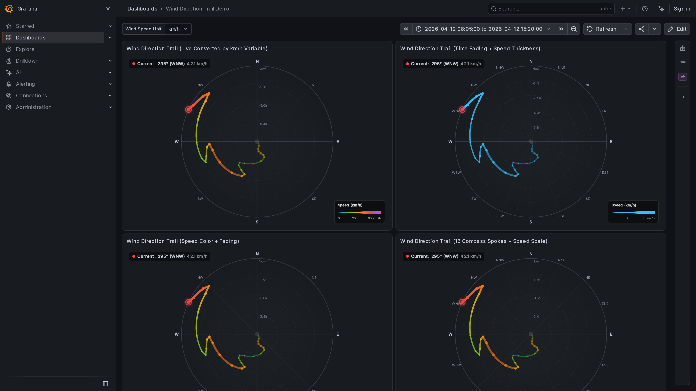
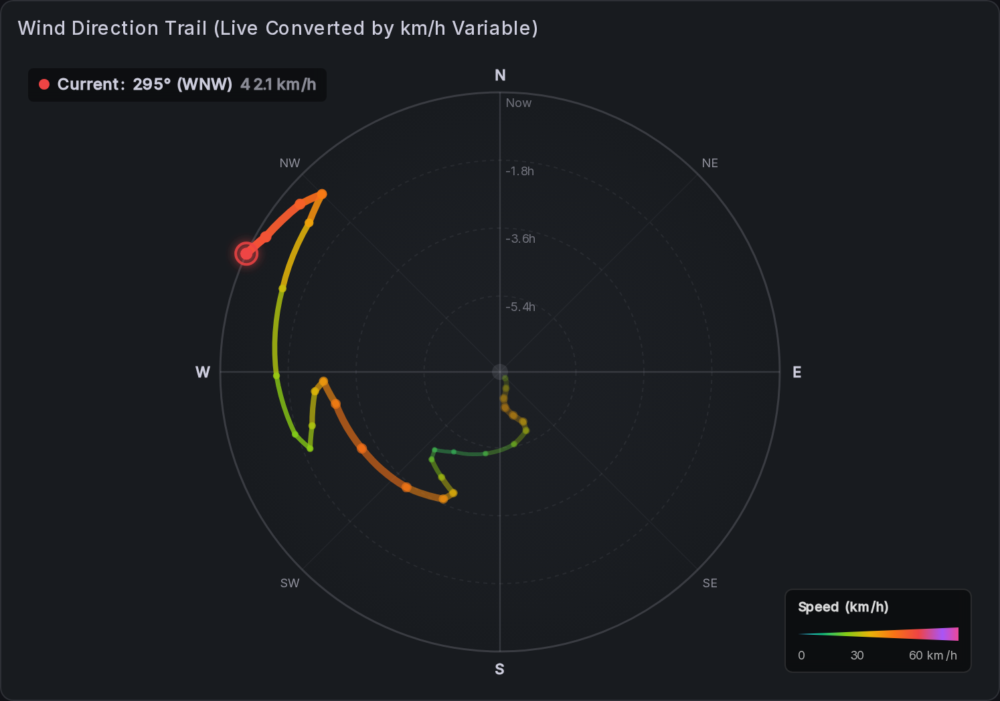
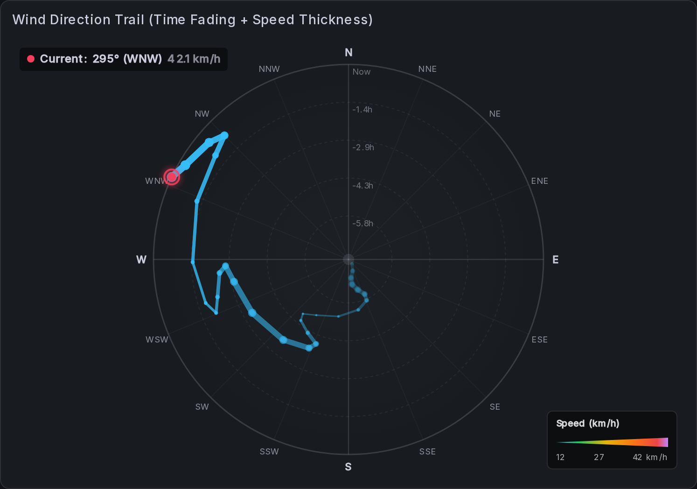

# Wind Direction Trail Panel for Grafana

Visualize **wind direction over time** as a continuous trail on a 360° compass rose.

A classic line chart breaks apart whenever the wind swings across north (359° ↔ 1°). This panel avoids that: **direction is the angle, time is the radius**. The trail starts at the centre and winds outward to the present (or the other way round), so shifts, backing/veering and gusts are visible at a glance.

## Features

- Polar trail with time rings (`-6h`, `-3h`, `Now`) and a 4, 8 or 16-point compass rose
- Colour by **wind speed** (Windy-style gradient or discrete weather bands), by **time fade**, or a **solid colour**
- Line width scales with speed; optional comet-tail taper toward the past
- Live readout of current direction, cardinal heading and speed, plus min, max and average speed
- **Direction variation sector** that shows how far the wind swung during the selected range, correctly handling shifts across north
- Speed legend with unit conversion (m/s, km/h, knots, mph, ft/s, Beaufort)
- Tooltip with timestamp, degrees, heading and speed for each point
- Responsive layout: right sidebar on wide panels, bottom bar on compact ones

  
  

## Requirements

- Grafana **10.0 or newer**
- Any data source that returns a table or time-series frame; no backend component is needed

## Data requirements

| Field             | Required | Details                                                                                                      |
| :---------------- | :------- | :----------------------------------------------------------------------------------------------------------- |
| Time              | Yes      | Standard time field.                                                                                         |
| Wind direction    | Yes      | Numeric degrees, 0–360 (for example `wind_dir`, `direction`, `bearing`, `heading`).                           |
| Wind speed        | No       | Numeric, in m/s, km/h, knots, mph or ft/s (for example `wind_speed`, `velocity`). Without it the trail is drawn without speed colouring and width scaling. |

The panel auto-detects the fields from their names and units. If detection picks the wrong field, select the direction and speed fields explicitly under **Field mapping**. If your query returns direction and speed as separate series, join them by time with a *Join by field* transformation first.

## Getting started

1. Add a panel and choose **Wind Direction Trail** as the visualization.
2. Write a query that returns time, direction and (optionally) speed.
3. If the speed unit is not detected, set **Input speed unit** and choose a **Display speed unit**.
4. Pick the time orientation and colour mode that suit you.

## Configuration guidance

All options are in the panel editor.

- **Layout and coordinates**
  - *Time direction*: oldest in the centre and newest at the rim, or the reverse.
  - *Time range source*: `data` scales to the first and last point; `dashboard` follows the time picker.
  - *Compass points*: 4, 8 or 16 spokes. *Ring count*: 2 to 8 time rings.
  - *Info placement*: automatic, right sidebar, bottom bar or overlay.
- **Trail styling**
  - *Color mode*: `speed` or `solid`. *Palette*: `windy` (smooth) or `standard` (discrete bands).
  - *Curve mode*: `polar` follows the compass arc; `linear` draws straight chords.
  - *Fade over time* and *Scale width by speed* with min and max stroke width.
  - *Show points*, with auto-hide above 80 points to avoid clutter.
- **Latest marker**: highlight the newest reading and show or hide the current-wind readout.
- **Field mapping and units**
  - *Direction field* and *Speed field* override auto-detection.
  - *Max data points* (default 150, `0` disables) thins large queries by downsampling. Raise it for more detail.
  - *Input speed unit* and *Display speed unit*. The display unit can also be a dashboard variable.
  - *Speed scale mode*: `fixed` (meteorological range), `auto` (current min and max) or `custom` (set min and max).
- **Direction variation sector**: show the swing as a `rim` arc, a `wedge` or two boundary `lines`. Calm readings (speed 0) are ignored.
- **Legend**: show or hide, choose its position and shape (rectangle or triangle), and toggle the min and max pins.

## Tips

- For long ranges, a small *Ring count* and the default *Max data points* keep the trail readable.
- Use *Time range source = dashboard* when comparing several panels over the same window.
- A calm reading carries no meaningful direction; it is excluded from the variation sector but still plotted.

## Documentation and feedback

Source code, issues and the changelog are on [GitHub](https://github.com/jhoos70/grafana-windtrail-panel). Contributions are welcome.

## License

Apache-2.0
